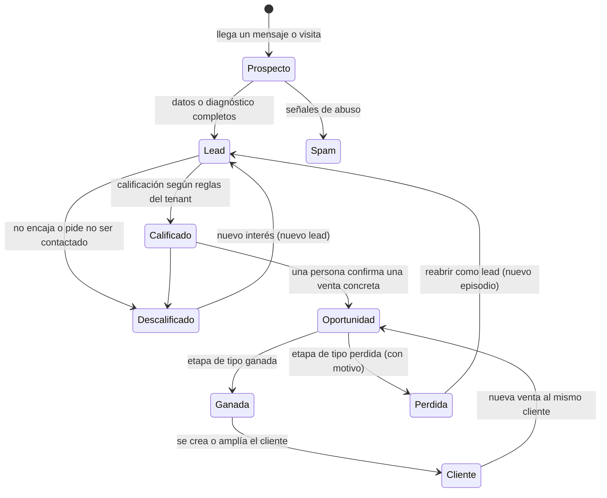

# Flujo comercial: Prospecto → Lead → Oportunidad → Cliente

> Parte de [ADR-0010](../decisions/0010-conversaciones-y-datos-de-prospectos.md). **Propuesto, sin código.** Fecha: 2026-11-06.
> Tablas en [data-catalog.md](data-catalog.md). Niveles de autonomía: Constitución y ADR-0009 (ambos propuestos, aún sin fusionar).

## 1. Principio: una persona, una identidad; el embudo son etapas y relaciones

El diseño clásico de CRM que separa "tabla de prospectos", "tabla de leads" y "tabla de clientes" duplica personas, pierde el historial al "convertir" y obliga a copiar datos. Aquí:

- Una persona es **un `contacts`** desde su primer mensaje hasta que es cliente (y después).
- Lo que cambia es **qué relación comercial tiene**: un `lead` (interés), una `opportunity` (venta posible), un `customer` (relación vigente).
- Nada se borra ni se copia al avanzar: se **crean registros nuevos que apuntan al mismo contacto**, y el historial (`activities`, `conversations`) sigue siendo uno solo.

| Término | Qué es en la base | Cómo se reconoce |
|---------|-------------------|------------------|
| **Prospecto** | Un `contact` con conversación y **sin lead abierto**. Puede ser anónimo (`web_visitor`) | `contacts.lifecycle_stage = 'prospect'` |
| **Lead** | Un `lead` abierto: el contacto mostró interés y NEX (o una persona) lo evaluó o recogió sus datos | `leads.status in ('new','working','qualified')` |
| **Oportunidad** | Una `opportunity` abierta: hay una **venta concreta** con importe estimado, etapa, responsable y próxima acción | `opportunities.status = 'open'` |
| **Cliente** | Un `customer` activo: se ganó al menos una oportunidad | `customers.status = 'active'` |

## 2. Máquinas de estado

Los estados viven en columnas distintas a propósito:

| Entidad | Estados (`status`) | Quién puede cambiarlos |
|---------|--------------------|------------------------|
| `leads` | `new` → `working` → `qualified` → `converted`; o `disqualified`, `spam` | Función `advance_lead`. NEX propone; una persona confirma las salidas |
| `opportunities` | `open` → `won` / `lost`, según `pipeline_stages.kind` | Función `move_opportunity` (solo personas, o autorización explícita en el futuro) |
| `customers` | `active` ↔ `inactive` | Función `convert_to_customer` y mantenimiento |
| `contacts.lifecycle_stage` | `prospect` · `lead` · `customer` · `former` | **Solo las funciones anteriores**; derivada, nunca editada a mano |

## 3. Transiciones: qué pasa en cada paso

| # | Transición | Dispara | Registros que crea o cambia (misma transacción) | Nivel de autonomía | Requisito |
|---|-----------|---------|--------------------------------------------------|--------------------|-----------|
| 1 | **Llega un mensaje** (visita, WhatsApp, correo…) | Canal → `ingest_inbound` | `inbound_events` (+`inbound_dedup`); `contact_identities` y `contacts` (si no existía, `prospect`); `conversations`; `messages`; `consent_records` si se mostró el aviso; `action_log` | **1** (observar y registrar) | Resolución por identidad: si el identificador ya existe, se reutiliza el contacto |
| 2 | **Prospecto → Lead** | El chat guiado completa el diagnóstico o el visitante deja sus datos o pide una persona | `assessment_runs` (inmutable); `leads` (`new`); `handoffs`; `contacts.lifecycle_stage = lead`; `activities` (`conversation_summary`); `action_log` | **1**: crear registros internos no contacta a nadie | Un solo lead abierto por contacto (índice único parcial) |
| 3 | **Calificación** | Reglas del `pack_versions` aprobado, ejecutadas por código | `leads.grade/points/qualification/priority`, `status = qualified` o `working`; `audit_log` | **1** (cálculo determinista; el modelo no puntúa) | Versión de reglas guardada en el lead |
| 4 | **Primer contacto saliente** (p. ej. la solicitud de reunión) | NEX prepara; el propietario decide | `approval_requests` (`pending`) → al aprobar: `outbox_messages` + `messages` (`out`, `queued`); `activities`; `action_log` con la aprobación | **3**: primer contacto siempre se confirma (ADR-0009) | `outbox` exige aprobación o autorización vigente |
| 5 | **Lead → Oportunidad** | **Una persona** confirma que hay una venta concreta (importe, responsable y próxima acción) | `opportunities` (`open`, etapa inicial, con `owner_user_id` y `next_action_at`); `opportunity_stage_history`; `leads.status = converted` y `converted_opportunity_id`; `tasks`; `action_log` | **3**: afecta a previsiones y finanzas. NEX **propone** (nivel 1) | Reglas de Sales como `CHECK` |
| 6 | **Avance de etapa** | Persona (o integración, más adelante) | `opportunities.stage_id`; `opportunity_stage_history`; `audit_log` | **3** hoy; ampliable con evidencia | Solo etapas del pipeline del tenant |
| 7 | **Oportunidad ganada** | Persona; en el futuro, el **pago confirmado** | `opportunities.status = won`, `won_at`; `activities` | **3** (contractual y financiero) | Etapa de tipo `won` |
| 8 | **Ganada → Cliente** | Misma transacción que el paso 7 | `customers` (se **crea o se amplía** si ya existía el cliente); `opportunities.customer_id`; `contacts.lifecycle_stage = customer`; `action_log` | **3** | Un solo cliente activo por persona u organización |
| 9 | **Oportunidad perdida** | Persona | `opportunities.status = lost` con `lost_reason`; si el contacto no tiene más, vuelve a `lead` o `former` | **3** | `lost_reason` obligatorio |
| 10 | **Descalificar / spam** | Reglas (spam) o persona | `leads.status = disqualified/spam` con motivo; `conversations.status = quarantined` si es spam | Spam en cuarentena: **1** (revisable, nunca se borra solo) | Motivo obligatorio |
| 11 | **Reabrir** | Nuevo mensaje de un contacto que ya fue lead, o decisión de una persona | **Nuevo** `lead` (nuevo episodio); el anterior queda como historia | **1** | No hay lead abierto |

> **Por qué NEX no crea oportunidades ni clientes por su cuenta:** una oportunidad entra en la previsión de ventas y un cliente es una relación contractual. Son decisiones de negocio con consecuencias financieras; por la Constitución y ADR-0009 (clasificación de acciones financieras/contractuales) se proponen en nivel 1 y se **confirman en nivel 3**. Con evidencia de acierto, una autorización explícita podría automatizar los casos más acotados (p. ej. marcar ganada una oportunidad cuando el pago se confirma), nunca antes de ADR-0009 aceptado.

## 4. Invariantes (las impone la base de datos)

1. Un contacto tiene **como máximo un lead abierto** (índice único parcial).
2. Una oportunidad **abierta** siempre tiene responsable y próxima acción con fecha; una **perdida** siempre tiene motivo; una **descalificada**, también (`CHECK`).
3. Un lead convertido **no se elimina**: queda enlazado a la oportunidad y al cliente resultante.
4. Una oportunidad **ganada** crea o amplía exactamente un `customer`.
5. `contacts.lifecycle_stage` **siempre** coincide con lo que dicen sus lead, oportunidad y cliente (la mantiene una única función; una prueba lo verifica).
6. Ninguna transición ocurre sin su `action_log` en la misma transacción.
7. Ninguna fila apunta a otro tenant (FK compuestas).

## 5. Contactos duplicados

- La **deduplicación automática** solo se hace por **identificador exacto** (`contact_identities`): el mismo correo, teléfono o cuenta de canal es la misma persona.
- Coincidencias **difusas** (mismo nombre, otro canal) **no se fusionan solas**: NEX **sugiere** (nivel 1) y una persona confirma (nivel 3).
- **Fusionar**: el contacto perdedor recibe `merged_into_id`; sus identidades, conversaciones, leads, actividades y oportunidades se reasignan al ganador en una transacción; todo queda en `audit_log`. La fusión no se deshace en bloque, pero el registro permite reconstruirla.

## 6. Un recorrido completo (el ejemplo del MVP, ya con base de datos)

1. Ana escribe en el chat web de Nova → `ingest_inbound` crea `contact_identities (web_visitor)`, `contacts (prospect)`, `conversations (guided)` y la conversación avanza.
2. Ana completa el audit y deja su correo → `assessment_runs` (score 42), `contact_identities (email)` (el visitante se **vincula** a un correo), `leads (new)`, `handoffs`.
3. Reglas del paquete aprobado → `grade = hot`, `priority = high`, `status = qualified`.
4. NEX prepara la solicitud de reunión → `approval_requests (pending)`. El **Dashboard** muestra "Necesita tu aprobación" leyendo esa tabla.
5. Jeffrey aprueba → `outbox_messages` → el procesador envía por el canal → `messages (out, sent)` → `activities (meeting requested)`.
6. Tras la reunión, una persona crea la oportunidad (importe, responsable, próxima acción) → `opportunities (open)`; el lead pasa a `converted`.
7. Se negocia y se gana → `opportunities (won)` → `customers (active)` → `contacts.lifecycle_stage = customer`. Si el cobro llega por una pasarela, `payments (succeeded)` queda enlazado al cliente y a la oportunidad.
8. Meses después Ana escribe de nuevo → mismo contacto, mismo historial; si hay una nueva venta, una **nueva oportunidad** sobre el **mismo cliente**.

## 7. Qué consulta cada pantalla

| Pantalla | Lee de | Clave de rendimiento |
|----------|--------|----------------------|
| Dashboard "Mientras no estabas" | `action_log` desde la última visita + `metrics_daily` | Rollups; nunca `count(*)` sobre tablas grandes |
| Necesita tu aprobación | `approval_requests where status = 'pending'` | Índice parcial por tenant y estado |
| Pipeline de leads | `leads` por `(tenant_id, status, priority, next_action_at)` | Paginación por clave, no por desplazamiento |
| Tablero de oportunidades | `opportunities` por `(tenant_id, pipeline_id, stage_id)` | Índice por etapa |
| Bandeja de conversaciones | `conversations` por `(tenant_id, status, last_message_at desc)` | Columna denormalizada `last_message_at` |
| Línea de tiempo del contacto | `activities` + `conversations`/`messages` por contacto | `(tenant_id, contact_id, occurred_at desc)` |
