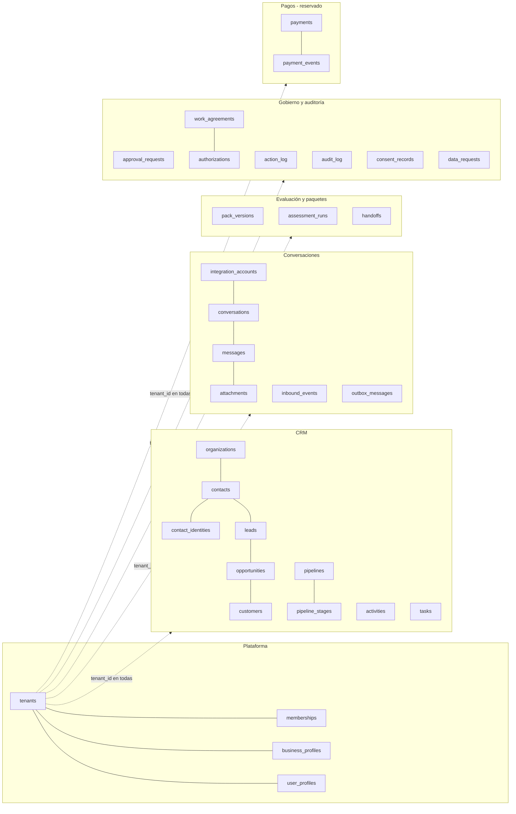
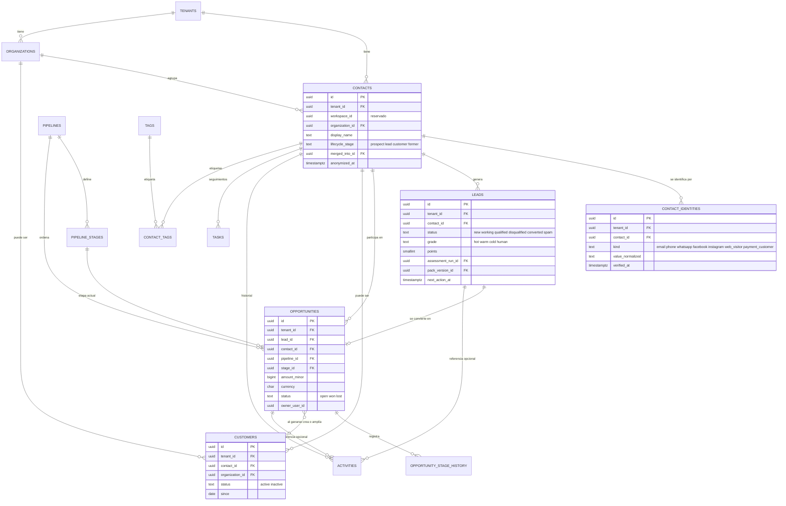
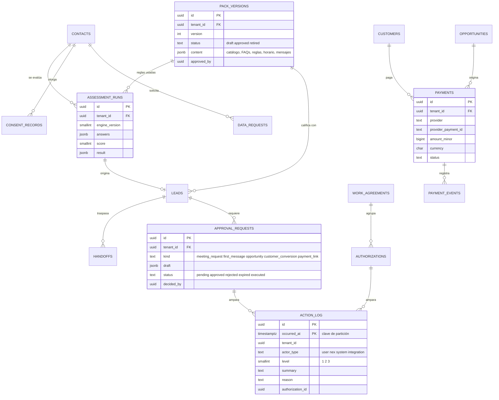

# Modelo entidad-relación (ER) — Conversaciones y datos de prospectos

> Parte de [ADR-0010](../decisions/0010-conversaciones-y-datos-de-prospectos.md). **Propuesto, sin código.** Fecha: 2026-11-06.
> Columnas, índices y políticas de cada tabla: [data-catalog.md](data-catalog.md). Los diagramas usan Mermaid (GitHub los dibuja).
> Convenciones: identificadores en inglés, `snake_case`; toda tabla de negocio lleva `tenant_id`; `workspace_id` es nulo y reservado.

## 1. Vista general por dominios

## 2. Núcleo comercial: del prospecto al cliente

## 3. Conversaciones y canales

```mermaid
erDiagram
  INTEGRATION_ACCOUNTS ||--o{ CONVERSATIONS : "recibe"
  CONTACTS ||--o{ CONVERSATIONS : "conversa"
  CONVERSATIONS ||--o{ MESSAGES : "contiene"
  MESSAGES ||--o{ ATTACHMENTS : "adjunta"
  CONVERSATIONS ||--o{ LEADS : "origina"
  INTEGRATION_ACCOUNTS ||--o{ INBOUND_EVENTS : "recibe crudos"
  INTEGRATION_ACCOUNTS ||--o{ OUTBOX_MESSAGES : "envía por"
  CONVERSATIONS ||--o{ OUTBOX_MESSAGES : "origina"
  APPROVAL_REQUESTS ||--o{ OUTBOX_MESSAGES : "autoriza"

  INTEGRATION_ACCOUNTS {
    uuid id PK
    uuid tenant_id FK
    text category "conversation payment"
    text provider "web_chat whatsapp facebook instagram email form stripe paypal makapay makawallet sinpe"
    text status "pending active paused error revoked"
    text secret_ref "puntero, nunca el secreto"
    text inbound_key_hash
  }
  CONVERSATIONS {
    uuid id PK
    uuid tenant_id FK
    uuid integration_account_id FK
    uuid contact_id FK
    text status "open waiting handed_off closed quarantined"
    text mode "guided human free"
    text external_thread_id
    timestamptz last_message_at
    timestamptz window_expires_at
  }
  MESSAGES {
    uuid id PK
    timestamptz created_at PK "clave de partición"
    uuid tenant_id
    uuid conversation_id
    text direction "in out system"
    text sender_kind "contact user nex system"
    text content_type
    text delivery_status
    text provider_message_id
  }
  INBOUND_EVENTS {
    uuid id PK
    timestamptz received_at PK "clave de partición"
    uuid integration_account_id FK
    text external_event_id
    boolean signature_valid
    jsonb payload
    text status
  }
  OUTBOX_MESSAGES {
    uuid id PK
    uuid tenant_id FK
    text idempotency_key "único"
    text status "pending sending sent failed cancelled"
    uuid approval_request_id FK
  }
```

## 4. Evaluación, paquetes, gobierno y auditoría

## 5. Reglas del modelo (resumen)

1. **Una sola identidad por persona** (`contacts`); prospecto, lead y cliente son **etapas y relaciones** de esa identidad, no tablas duplicadas.
2. **Toda referencia entre tablas de negocio es compuesta** `(tenant_id, id)`: la base impide que una fila apunte a otra empresa (ver [multitenancy.md](multitenancy.md)).
3. **Las tablas de mayor volumen** (`messages`, `inbound_events`, `action_log`, `audit_log`, `payment_events`) se **particionan por mes**; ninguna otra tabla se parte al inicio.
4. **Los hechos inmutables** (evaluaciones, traspasos, historial de etapas, consentimientos, registros de acción y auditoría, eventos de pago) **solo se insertan**.
5. **Ningún secreto en la base**: `integration_accounts.secret_ref` apunta a donde vive el secreto.
6. **Dinero** en unidades menores enteras (`bigint`) con moneda `char(3)`; nunca decimales ni flotantes.
