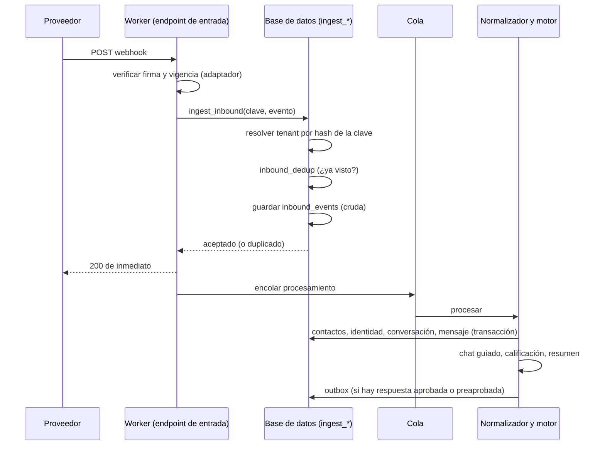
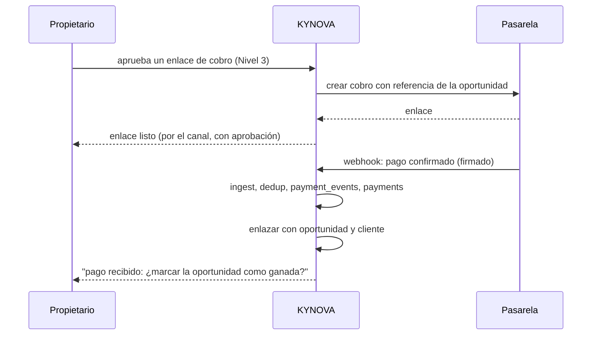

# Arquitectura de integraciones (canales y pagos)

> Parte de [ADR-0010](../decisions/0010-conversaciones-y-datos-de-prospectos.md). **Propuesto, sin código.** Fecha: 2026-11-06.
> Canales: chat web, WhatsApp, Facebook, Instagram, correo y formularios. Pagos: Stripe, PayPal, MakaPay, MakaWallet y SINPE.
> **Honestidad sobre lo que no sé:** no tengo las especificaciones de MakaPay ni de MakaWallet, y SINPE no es una pasarela con la forma habitual; las reglas de plataformas como Meta cambian. Todo lo marcado **a verificar** se confirma antes de construir ese adaptador. Este documento define la **forma común**, no los detalles de cada proveedor.

## 1. Principio: puertos y adaptadores

El Pipeline, el Dashboard, el motor de calificación y NEX **no saben por qué canal llegó un mensaje ni por qué pasarela llegó un pago**. Hablan un **idioma interno normalizado**; cada proveedor tiene un **adaptador** que traduce en ambos sentidos.

```
Proveedor ──► Adaptador (verifica y traduce) ──► Evento normalizado ──► Núcleo (contactos, conversaciones, leads, pagos)
Núcleo ──► Intención saliente aprobada ──► Outbox ──► Adaptador (traduce y envía) ──► Proveedor
```

Agregar un canal significa **escribir un adaptador y registrar una `integration_accounts`**: no se toca el núcleo (es el mismo principio que ya se demostró en el MVP con `Handoff` → `leadFromHandoff`).

## 2. Contratos normalizados

### Entrada de conversación (`NormalizedInbound`)
| Campo | Notas |
|-------|-------|
| `provider`, `integration_account_id` | Resuelto por la clave de entrada, nunca por el cuerpo |
| `external_event_id` | Para idempotencia |
| `external_thread_id` | Hilo del proveedor |
| `sender` | `{kind, provider_scoped_id, display_name?, locale?}`: se convierte en `contact_identities` |
| `received_at`, `sent_at` | Se guardan ambos: el proveedor puede retrasarse |
| `content` | `{type: text/media/choice/event, text?, attachments?, payload?}` |
| `consent` | Si el canal registra el aviso mostrado o el opt-in |

### Salida (`OutboundIntent`)
`{integration_account_id, conversation_id, content, idempotency_key, approval_request_id | authorization_id}`. **Sin amparo no hay salida**: la función que inserta en el outbox lo exige.

### Evento de pago (`NormalizedPayment`)
`{provider, integration_account_id, provider_payment_id, event_type, status, amount_minor, currency, fee_minor?, occurred_at, references: {opportunity_id?, customer_id?, invoice_id?}, raw_ref}`. Los **importes** son enteros en unidades menores; los **estados** se normalizan a `pending / succeeded / failed / refunded / disputed`.

### Contrato del adaptador (descripción, no código)
| Operación | Conversación | Pago |
|-----------|--------------|------|
| `verify(request)` | Firma y vigencia del webhook | Firma del webhook |
| `parse(request)` | → `NormalizedInbound[]` | → `NormalizedPayment[]` |
| `send(intent)` | Enviar un mensaje o plantilla | Crear un enlace o intento de cobro |
| `capabilities()` | Ventanas, plantillas, adjuntos, límites | Monedas, reembolsos, disputas |
| `health()` | Estado de la conexión y del token | Estado de la cuenta |

## 3. Flujo de entrada



Garantías: **responder rápido** (los proveedores reintentan si tardas); **idempotencia** por `inbound_dedup`; **reprocesable** porque la carga cruda queda guardada; **nada se pierde** si la cola falla (el evento ya está en `inbound_events`, y un proceso barre los `received` antiguos).

## 4. Flujo de salida

1. Alguien o algo **decide** responder: el chat guiado (mensajes preaprobados), una persona, o NEX bajo autorización.
2. Se evalúa el **nivel** de la acción en código: primer contacto, comunicación sensible o canal nuevo ⇒ **aprobación** (`approval_requests`).
3. Con amparo, se inserta `outbox_messages` con `idempotency_key` **en la misma transacción** que `messages (out, queued)` y `action_log`.
4. Un procesador respeta el **límite de tasa** del canal y la **ventana** de la conversación (`window_expires_at`), llama al adaptador y actualiza `delivery_status`.
5. Los **estados de entrega** (enviado, entregado, leído, fallido) llegan por webhook y se correlacionan por `provider_message_id`.
6. Un fallo se reintenta con retroceso y, agotado, queda `failed` con alerta: **nunca se reenvía sin la misma clave de idempotencia**.

## 5. Seguridad de las integraciones

| Tema | Regla |
|------|-------|
| **Firmas** | Todo webhook se verifica con el método del proveedor antes de tocar la base; `inbound_events.signature_valid` queda registrado; un evento con firma inválida se descarta y se cuenta |
| **Repetición** | Ventana de tiempo máxima por evento + `inbound_dedup` |
| **Secretos** | **Nunca en la base ni en el repositorio.** `integration_accounts.secret_ref` apunta a Cloudflare (secretos de Worker) o a Supabase Vault (**decisión abierta**). Rotación documentada; revocar una cuenta pone `status = revoked` y detiene ingesta y envío |
| **Resolución del tenant** | Por el **hash de la clave de la URL de entrada** o por el `external_account_id` del proveedor; **nunca** por un campo que envíe el remitente |
| **Mínimo privilegio** | El Worker de entrada solo ejecuta `ingest_*`; no lee tablas |
| **Adjuntos** | Se guardan en R2 con prefijo por tenant, se **escanean** antes de mostrarlos y no se siguen redirecciones del proveedor sin lista permitida (evita SSRF) |
| **Datos personales** | Los registros no llevan cuerpos ni identificadores completos; `inbound_events` es de acceso exclusivo del servidor |
| **Abuso** | Límite de tasa por tenant, canal e IP; campo trampa y verificación anti-bots en el chat web; los sospechosos van a **cuarentena** revisable |
| **Consentimiento** | `consent_records` registra aviso y opt-in por contacto y canal; **no se envía por canales que exigen opt-in sin él** |

## 6. Canales de conversación

| Canal | Entrada | Salida | Identidad (`contact_identities.kind`) | Particularidades (**a verificar**) |
|-------|---------|--------|----------------------------------------|-------------------------------------|
| **Chat web** | Endpoint propio del Worker (widget incrustado) | Misma conexión | `web_visitor` (cookie firmada), luego `email`/`phone` si lo da | Es el **único canal que existe hoy** (en demostración). Anti-abuso propio; aviso y consentimiento visibles |
| **Formularios** | `POST` con clave pública del tenant | Respuesta por correo o chat | `email`/`phone` | Mismo endpoint de ingesta; campo trampa |
| **WhatsApp** | Webhook de la plataforma de WhatsApp Business (Meta) | API de la plataforma | `whatsapp` (número E.164) | Ventana de atención de 24 h tras el último mensaje del cliente; fuera de ella solo **plantillas aprobadas**; opt-in; verificación del negocio; límites de calidad y tasa |
| **Facebook Messenger** | Webhook de Meta | API de Meta | `facebook_psid`, **con `provider` = la página**: el id es por página | Revisión de la app y permisos; ventana de respuesta con reglas propias |
| **Instagram** | Webhook de Meta | API de Meta | `instagram_igsid`, por cuenta | Misma plataforma y revisión que Facebook; reglas propias de mensajería |
| **Correo** | Recepción por enrutamiento de correo (Workers o un proveedor de entrada: **decisión abierta**) | Proveedor transaccional | `email` | Hilos por `Message-ID`/`In-Reply-To`; SPF, DKIM y DMARC por dominio del tenant; baja y cumplimiento de correo comercial |

**Un canal a la vez** (decisión C14 de la Constitución): cada uno tiene aprobaciones y plazos propios de la plataforma. `integration_accounts.capabilities` guarda sus límites (ventana, plantillas, adjuntos) para que el motor **no pueda** intentar algo que el canal no permite.

## 7. Pagos

### Principios
1. **Nunca se guardan datos de tarjeta ni credenciales de pago.** Solo identificadores y estados del proveedor. Los cobros usan **páginas o enlaces alojados por el proveedor**, para que la plataforma quede fuera del alcance más estricto de la norma de tarjetas (**confirmar con el proveedor y con asesoría**).
2. **Un pago es un hecho que llega por evento**, no una escritura de la interfaz: `payment_events` (append-only) → el procesador actualiza `payments` de forma **idempotente**.
3. **Crear un cobro o enlace de pago es una acción financiera ⇒ Nivel 3** (siempre confirmación). Recibir un pago **no** requiere confirmar para registrarse (es un hecho), pero **marcar la oportunidad como ganada** se propone y se confirma.
4. **Importes enteros en unidades menores** y moneda explícita; las conversiones, comisiones y reembolsos son filas, no sobrescrituras.
5. Un pago se enlaza a un **cliente y a una oportunidad** por la referencia que el cobro llevó (identificador propio en los metadatos o la referencia del enlace) y, si no la tiene, queda **sin asignar** para revisión humana.

### Flujo


### Proveedores
| Proveedor | Cómo llega el estado | Notas (**a verificar**) |
|-----------|----------------------|--------------------------|
| **Stripe** | Webhooks firmados; id de evento para idempotencia | Pago alojado (Checkout / Payment Links); `payment_customer` como identidad; disputas y reembolsos como eventos |
| **PayPal** | Webhooks con verificación de firma por su API; órdenes y capturas | Reembolsos y disputas como eventos |
| **SINPE** (Costa Rica) | **Por definir.** SINPE Móvil es una transferencia entre cuentas bancarias; no es una pasarela comercial estándar con webhooks. Opciones a investigar: conciliación por notificación o extracto del banco, o mediante un agregador que sí exponga API | Modelo previsto: `payment_events` de origen **conciliación** con asignación manual o asistida; **no se asume** una API |
| **MakaPay** | **Por definir: no tengo su especificación.** Se requiere documentación de autenticación, creación de cobros, webhooks, estados, liquidación y entorno de pruebas | Entra por el **mismo contrato** `NormalizedPayment` |
| **MakaWallet** | **Por definir: ídem.** Billetera: puede implicar saldos, transferencias y retiros además de cobros | Fuera del alcance de pagos de cobro hasta tener su especificación; el modelo `payments.kind` admite ampliarse |

Cuentas de pago: son filas de `integration_accounts` con `category = 'payment'`; su estado, credenciales (por referencia) y capacidades (monedas, reembolsos) se gestionan igual que las de los canales.

## 8. Qué se prepara ahora y qué después

| Pieza | Ahora (arquitectura y contratos) | Después |
|-------|----------------------------------|---------|
| `integration_accounts`, `inbound_events`, `inbound_dedup`, `outbox_messages` | Diseñadas (M3) | Construidas con el chat web |
| Contratos `NormalizedInbound`/`OutboundIntent`/`NormalizedPayment` | Definidos aquí; se escriben en `lib/contracts/` al implementar | Cada adaptador los cumple |
| Adaptador del chat web | Primero (ya existe el flujo en demostración) | M3 |
| WhatsApp, Facebook, Instagram, correo | **Solo declarados** (`CHANNEL_STATUS` = `planned`) | Uno por vez, cada uno con su revisión de plataforma y su ADR si cambia algo estructural |
| `payments`, `payment_events` | Diseñadas; **no se crean** (M7) | ADR de pagos, tras onboarding |
| Procesadores y colas | Descritos | Cuando haya volumen medido |

## 9. Lista de verificación para agregar un canal

1. ¿Tiene firma verificable y ventana de repetición? 2. ¿Qué identidad aporta y de qué alcance (por cuenta o por página)? 3. ¿Requiere opt-in o plantillas? 4. ¿Qué límites de tasa y de ventana tiene? 5. ¿Qué pasa con adjuntos y con datos personales? 6. ¿Cómo se renuevan sus credenciales? 7. ¿Qué cambia en el consentimiento y el aviso de datos? 8. ¿Hay revisión o aprobación de la plataforma, con qué plazo? 9. ¿Qué pruebas de adaptador hay (firma inválida, repetido, fuera de orden)? 10. Tras todo eso: **el adaptador y la fila de `integration_accounts`; ningún cambio en el núcleo.**

## 10. Preguntas abiertas

1. ¿Dónde viven los secretos de integración: Cloudflare, Supabase Vault o ambos?
2. Recepción de correo: ¿enrutamiento de Cloudflare o un proveedor de entrada?
3. SINPE: ¿conciliación bancaria, agregador, o ambos?
4. MakaPay y MakaWallet: documentación técnica, entornos de prueba y modelo de liquidación.
5. ¿Qué cuenta de Meta (empresa y verificación) usará cada tenant, y quién gestiona la revisión de la app?
